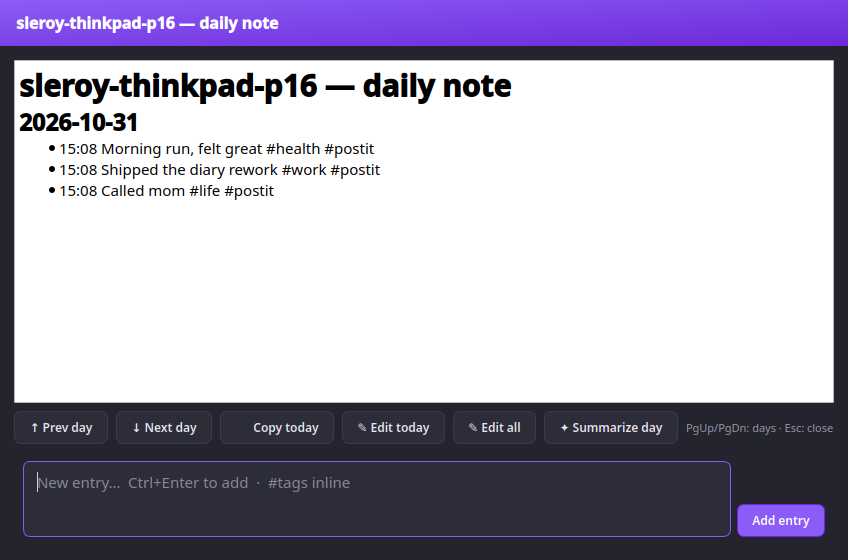
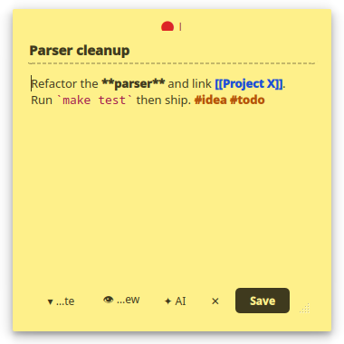
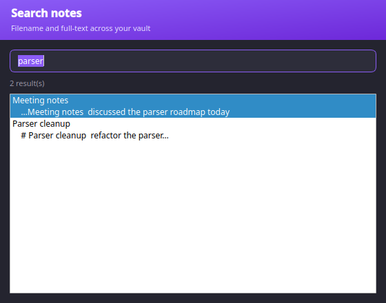
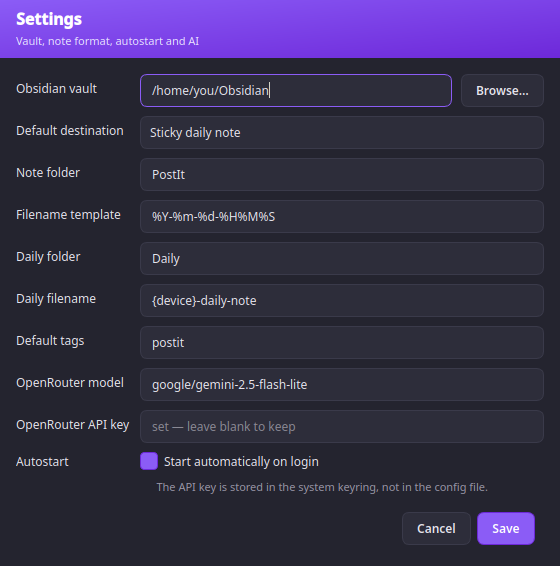

<div align="center">


# Obsidian PostIt

### Quick sticky notes from your KDE tray, straight into your Obsidian vault.

No waiting for Obsidian to launch — jot a thought or stash the clipboard, and it
lands as clean Markdown your vault indexes the next time you open it.

<br/>

[](https://github.com/sleroy/obsidian-postit-kde/actions/workflows/ci.yml)
[](https://www.python.org/)
[](https://doc.qt.io/qtforpython/)
[](https://kde.org/plasma-desktop/)
[](LICENSE)

<br/>



</div>

---

## Why

Obsidian is wonderful — and heavy to open for a single line. Classic sticky-note
apps (KNotes is discontinued, Xpad, Indicator Stickynotes) are light but trap
your notes in their own silos. **Obsidian PostIt** gives you the tray-capture
convenience *and* keeps everything in a real Markdown vault: full Obsidian
search, tags and backlinks, no lock-in, no Obsidian process required.

## Two surfaces: Diary & Notes

|  |  |
|---|---|
| **📔 Diary** — a continuous daily journal, one rolling file per device (`Daily/<device>-daily-note.md`). Open it to read today's entries, scroll back through past days (`PgUp`/`PgDn`), add a timestamped entry, copy a day, edit a day or the whole document, or **summarize a day** with AI into one entry. | **🗒️ Notes** — discrete sticky post-its, one tidy `.md` each in `PostIt/`, filename **guessed from your content**. Create, edit in place, or delete. For things you'll keep, link or expand. |

## Features

### Diary
- 📖 **Read your journal** — the whole rolling document, scrolled to today
- ✍️ **Add entries** — a quick box appends a timestamped bullet under today
- ↕️ **Jump between days** with `PgUp` / `PgDn` or Prev/Next buttons
- 📋 **Copy a day** to the clipboard in one click
- ✎ **Edit today's section** or free-edit the whole document (safe atomic save)
- ✦ **Summarize a day** — AI rewrites all of today's entries into one

### Notes
- 🎯 **Sticky capture** — the window *is* the note: a yellow post-it with an
  optional title and a body. Type, `Ctrl+Enter`, done. Resizable.
- 📋 **Clipboard capture** on demand (Wayland-friendly — user-initiated)
- ✏️ **Edit & delete** — open a note to change it in place, or delete it
- 🔎 **Recent & search** — your last 5 notes and full-text search across the vault

### Everywhere
- 🏷️ **Tags** — Obsidian `#tags` inline, highlighted live, mirrored to frontmatter
- ✨ **Syntax highlighting** (`#tags`, `[[wikilinks]]`, `**bold**`, *italic*,
  `` `code` ``) plus an **Edit ⇄ Preview** toggle
- 🤖 **Optional AI** (OpenRouter), run off the UI thread — key in the system
  keyring (KDE Wallet), **never** in a config file
- 🚀 **Autostart on login**, managed from Settings

## Screenshots

<div align="center">

| 📔 Diary — your daily journal | 🗒️ Note — a sticky post-it |
|:---:|:---:|
|  |  |

| 🔎 Search your notes | ⚙️ Settings |
|:---:|:---:|
|  |  |

</div>

## Install

Requires Python 3.13+ and PySide6. On Fedora KDE:

```bash
sudo dnf install python3-pyside6
pipx install .
```

Then add the menu launcher and icon:

```bash
install -Dm644 packaging/obsidian-postit-kde.desktop \
  ~/.local/share/applications/obsidian-postit-kde.desktop
install -Dm644 src/obsidian_postit_kde/resources/icon.svg \
  ~/.local/share/icons/hicolor/scalable/apps/obsidian-postit-kde.svg
```

See [PACKAGING.md](PACKAGING.md) for Flatpak and Fedora RPM instructions.

## Run

```bash
obsidian-postit-kde
```

On first launch, open **Settings** (right-click the tray icon) and pick your
Obsidian vault. **Left-click** the tray icon to open your **Diary**;
**right-click** for the Diary, a new note, clipboard capture, recent notes,
search, and settings.

## Configuration

Config lives at `~/.config/obsidian-postit-kde/config.toml` (human-editable).
The OpenRouter API key is stored in the system keyring, or read from the
`OPENROUTER_API_KEY` environment variable as a fallback.

| Key | Default | Meaning |
|---|---|---|
| `vault_path` | *(unset)* | Absolute path to your Obsidian vault |
| `default_destination` | `daily` | Preselected capture target (`daily` or `file`) |
| `subfolder` | `PostIt` | Folder for standalone notes |
| `daily_filename` | `{device}-daily-note` | Rolling daily file; `{device}` = hostname |
| `default_tags` | `["postit"]` | Tags added to every note |
| `openrouter_model` | `google/gemini-2.5-flash-lite` | Model for AI actions |
| `autostart` | `false` | Managed login autostart entry |

Full note-format spec and roadmap: [DESIGN.md](DESIGN.md).

## Development

```bash
python -m venv .venv && . .venv/bin/activate
pip install -e ".[dev]"

pytest          # 72 tests, no display needed
ruff check .
mypy src
```

## License

[MIT](LICENSE) © sleroy
