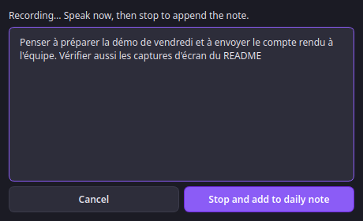

<div align="center">


# Obsidian PostIt

### Quick sticky notes from your KDE tray, straight into your Obsidian vault.

No waiting for Obsidian to launch — jot a thought or stash the clipboard, and it
lands as clean Markdown your vault indexes the next time you open it.

<br/>

[](https://github.com/sleroy/obsidian-postit-kde/actions/workflows/ci.yml)
[](https://www.python.org/)
[](https://doc.qt.io/qtforpython/)
[](https://kde.org/plasma-desktop/)
[](LICENSE)

<br/>


</div>

---

## Why

Obsidian is wonderful — and heavy to open for a single line. Classic sticky-note
apps (KNotes is discontinued, Xpad, Indicator Stickynotes) are light but trap
your notes in their own silos. **Obsidian PostIt** gives you the tray-capture
convenience *and* keeps everything in a real Markdown vault: full Obsidian
search, tags and backlinks, no lock-in, no Obsidian process required.

## Two surfaces: Diary & Notes

|  |  |
|---|---|
| **📔 Diary** — a continuous daily journal, one rolling file per device (`Daily/<device>-daily-note.md`). Open it to read one day at a time (`PgUp`/`PgDn`), add a timestamped entry, copy or edit today, edit the whole document, or **summarize today** with AI. | **🗒️ Notes** — discrete sticky post-its, one tidy `.md` each in `PostIt/`, filename **guessed from your content**. Create, edit in place, or delete. Keep several notes open alongside the Diary. |

## Features

### Diary
- 📖 **Read your journal** — one day at a time, starting with today
- ✍️ **Add entries** — a quick box appends a timestamped bullet under today
- 🎙 **Record a note** — dictate and watch the transcript appear live; it is
  appended to today's daily note. Runs **on your computer** (private, free) or
  through **OpenRouter** (no model to load, about $0.01 per hour of audio)
- ↔️ **Move between days** with `PgUp` / `PgDn` or Prev/Next buttons
- 🔗 **Open clipped notes** directly from their links in the Diary
- 📋 **Copy today's entries** to the clipboard in one click
- ✎ **Edit today's section** or free-edit the whole document (safe atomic save)
- ✦ **Summarize today** — AI rewrites all of today's entries into one
- ✅ **Create Todoist tasks** — start an entry with `todo:`; the Diary saves it, creates the task in the background, and adds an **Open in Todoist** link

### Notes
- 🎯 **Sticky capture** — the window *is* the note: a yellow post-it with an
  optional title and a body. Type, `Ctrl+Enter`, done. Resizable.
- 📋 **Clipboard capture** on demand (Wayland-friendly — user-initiated)
- ✏️ **Edit & delete** — open a note to change it in place, or delete it
- 🔎 **Recent & search** — your last 5 notes and full-text search across the vault

### Everywhere
- 🏷️ **Tags** — Obsidian `#tags` inline, highlighted live, mirrored to frontmatter
- ✨ **Syntax highlighting** (`#tags`, `[[wikilinks]]`, `**bold**`, *italic*,
  `` `code` ``) plus an **Edit ⇄ Preview** toggle
- 🤖 **Optional AI** (OpenRouter), run off the UI thread — key in the system
  keyring (KDE Wallet), **never** in a config file
- 🚀 **Autostart on login**, managed from Settings
- ⌨️ **KDE global shortcuts** for the Diary, a new note, and a note from the clipboard; configure them in Settings

## Screenshots

<div align="center">

| 📔 Diary — your daily journal | 🗒️ Note — a sticky post-it |
|:---:|:---:|
|  |  |

| 🎙 Record a note — live transcript | ⚙ Settings — voice notes |
|:---:|:---:|
|  |  |

| 🔎 Search your notes |
|:---:|
|  |

</div>

## Install

### Flatpak (any Linux distribution)

```bash
flatpak install --user https://sleroy.github.io/obsidian-postit-kde/obsidian-postit-kde.flatpakref
flatpak run io.github.sleroy.ObsidianPostitKde
```

The runtime comes from Flathub automatically. New versions then arrive with
`flatpak update`. Each [GitHub release](https://github.com/sleroy/obsidian-postit-kde/releases)
also carries a standalone `obsidian-postit-kde.flatpak` bundle
(`flatpak install --user obsidian-postit-kde.flatpak`). Voice notes are not
available in the Flatpak yet; use the pipx install below for them.

### pipx

Requires Python 3.13+ and PySide6. On Fedora KDE:

```bash
sudo dnf install python3-pyside6
pipx install .
```

For voice notes, install the optional speech dependencies with
`pipx install '.[speech]'` (or `pipx inject obsidian-postit-kde 'obsidian-postit-kde[speech]'`).
Open **Settings → Voice notes**, enable voice notes, choose a speech engine and
language, then select **Record a note** from the tray menu. The transcript is
shown live while you speak (can be turned off) and appended to today's daily note.

- **On this computer** (default): private and free. Uses the same whisper.cpp
  backend and cached model files as KiroCrew; a missing model downloads
  automatically. It runs in a separate process, so an engine crash never takes
  the tray app down. Larger models are more accurate but take longer to load
  and use more memory (`base` ≈ 142 MB, `large-v3-turbo` ≈ 1.6 GB).
- **OpenRouter (cloud)**: nothing to load, no memory used. Your audio is sent
  to OpenRouter's speech-to-text API with your OpenRouter key, for about
  $0.01–0.06 per hour of audio depending on the model
  (default `openai/whisper-large-v3-turbo`).

A microphone is required. If cleanup is enabled, the transcript (not the
audio) is sent to the AI model; a cleanup failure still saves the raw text.

Then add the menu launcher and icon:

```bash
install -Dm644 packaging/obsidian-postit-kde.desktop \
  ~/.local/share/applications/obsidian-postit-kde.desktop
install -Dm644 packaging/io.github.sleroy.ObsidianPostitKde.desktop \
  ~/.local/share/applications/io.github.sleroy.ObsidianPostitKde.desktop
install -Dm644 src/obsidian_postit_kde/resources/icon.svg \
  ~/.local/share/icons/hicolor/scalable/apps/obsidian-postit-kde.svg
```

See [PACKAGING.md](PACKAGING.md) for Flatpak and Fedora RPM instructions.

## Run

```bash
obsidian-postit-kde
```

On first launch, open **Settings** (right-click the tray icon) and pick your
Obsidian vault. **Left-click** the tray icon to open your **Diary**;
**right-click** for the Diary, a new note, clipboard capture, recent notes,
search, and settings.

## CLI

The same binary works headlessly — no display needed — writing exactly what the
GUI would. Handy for scripts, git hooks, cron, or over SSH:

```bash
obsidian-postit-kde add "Refactor the parser #idea"        # a sticky note
obsidian-postit-kde add "Meeting notes" -t "Standup"       # with a title
obsidian-postit-kde diary "Shipped the CLI #work"          # append to today's diary
echo "piped from anywhere" | obsidian-postit-kde add -     # read stdin
obsidian-postit-kde recent -n 5                            # list recent notes
obsidian-postit-kde search parser                          # full-text search
obsidian-postit-kde show-diary                             # print the diary
```

Running with no subcommand launches the tray GUI as usual.

## Clip a web page into your diary

Fetch a URL, convert it to Markdown, save it as a note, and drop a linked
bullet in today's diary — so you can stash useful things as you find them:

```bash
obsidian-postit-kde diary --url https://example.com/article --tags reading
```

A diary entry that is **just a URL** is auto-clipped the same way (mixed text is left alone). The article is stored in `PostIt/` and the diary gets a clickable `Clipped [[note]] — Title` link that opens the post-it.
The clipper isolates the page's main content (article/main region) and converts it to Markdown with trafilatura (best-in-class article extraction, bundled), with a built-in fallback. Nav, headers, footers, scripts and styles are dropped.

### Todoist tasks from the Diary

Add your personal Todoist API token in Settings. It is stored in the system keyring, like the OpenRouter key. You can also set `TODOIST_API_TOKEN` in the environment. Then enter, for example:

```text
todo: Buy milk tomorrow at 5pm #Shopping @groceries p1
```

The entry remains in your Diary. The app parses `today`, `tomorrow`, and `next Monday` style dates (with optional times), one `#Project`, `@labels`, `p1`–`p4`, and an optional ` // description`. It creates the task through Todoist and adds a clickable **Open in Todoist** link to that Diary entry. The Diary shows a failure message if the token or network is unavailable; the entry remains saved locally. Ordinary entries and clipped URLs are unchanged.

## Global shortcuts (KDE)

The app registers shortcuts through KDE's desktop portal when it starts. KDE may ask you to approve them once. Open **Settings → Configure KDE shortcuts…** to change the bindings. Suggested defaults are `Ctrl+Alt+D` for the Diary, `Ctrl+Alt+N` for a new post-it, and `Ctrl+Alt+Shift+N` for a post-it from the clipboard. They work while another application has focus.

The CLI remains available for custom KDE shortcuts:

```bash
obsidian-postit-kde --capture-note     # or --capture-diary
```

These commands open a one-shot capture popup and exit when you're done.

## MCP server (for AI agents)

The app can run as an [MCP](https://modelcontextprotocol.io) server over stdio,
exposing your vault to AI agents (Kiro, Claude, opencode, …) — they capture
notes and diary entries the same way the GUI does. Install the extra and run:

```bash
pipx inject obsidian-postit-kde mcp     # or: pip install "obsidian-postit-kde[mcp]"
obsidian-postit-kde mcp                 # speaks MCP over stdio
```

Register it with your agent, e.g.:

```json
{ "mcpServers": { "obsidian-postit": { "command": "obsidian-postit-kde", "args": ["mcp"] } } }
```

…or let the app write that config for you:

```bash
obsidian-postit-kde mcp-install claude      # Claude Desktop
obsidian-postit-kde mcp-install opencode    # opencode
obsidian-postit-kde mcp-install codex       # Codex
```

**Tools:** `add_note`, `add_diary_entry` (auto-clips a bare URL),
`add_diary_link` (clip a URL), `search_notes`, `recent_notes`, `read_note`
(confined to the vault), `read_diary`, `summarize_day`.
**Resources:** `obsidian-postit://diary`, `obsidian-postit://recent`.

## Configuration

Config lives at `~/.config/obsidian-postit-kde/config.toml` (human-editable).
OpenRouter and Todoist API tokens are stored in the system keyring. The app also
accepts `OPENROUTER_API_KEY` and `TODOIST_API_TOKEN` environment variables.

| Key | Default | Meaning |
|---|---|---|
| `vault_path` | *(unset)* | Absolute path to your Obsidian vault |
| `default_destination` | `daily` | Preselected capture target (`daily` or `file`) |
| `subfolder` | `PostIt` | Folder for standalone notes |
| `daily_filename` | `{device}-daily-note` | Rolling daily file; `{device}` = hostname |
| `default_tags` | `["postit"]` | Tags added to every note |
| `openrouter_model` | `google/gemini-2.5-flash-lite` | Model for AI actions |
| `speech_enabled` | `false` | Show the voice note action and prepare a local model |
| `speech_engine` | `local` | `local` (whisper.cpp on this computer) or `openrouter` (cloud) |
| `speech_model` | `base` | Local Whisper model (`tiny`, `base`, `small`, `large-v3-turbo`) |
| `speech_cloud_model` | `openai/whisper-large-v3-turbo` | OpenRouter speech-to-text model |
| `speech_language` | `auto` | Auto-detect or a two-letter language code |
| `speech_live_preview` | `true` | Show the transcript live while recording |
| `speech_clean_with_openrouter` | `false` | Optionally clean the transcript before saving |
| `autostart` | `false` | Managed login autostart entry |

Full note-format spec and roadmap: [DESIGN.md](DESIGN.md).

## Development

```bash
python -m venv .venv && . .venv/bin/activate
pip install -e ".[dev]"

pytest          # tests run without a display
ruff check .
mypy src
```

## License

[MIT](LICENSE) © sleroy
